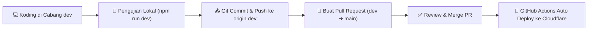

# Alur Kerja Pengembangan (Development Workflow)

Dokumen ini menjelaskan standar alur kerja pengembangan tim untuk repositori **Northstar IT Services**, mulai dari koding di cabang `dev` hingga otomatisasi deployment ke produksi melalui cabang `main`.

---

## 📌 Prinsip Utama

1. **Cabang `main` (Production)**:
   - Cabang rilis utama dan stabil.
   - Terkunci dari push langsung yang tidak terencana.
   - Setiap pembaruan yang masuk ke `main` akan **otomatis memicu deployment ke Cloudflare Workers**.
2. **Cabang `dev` (Development & Staging)**:
   - Cabang tempat koding sehari-hari dilakukan.
   - Push ke cabang `dev` **tidak akan** memicu deploy ke produksi.
3. **Penyatuan Kode (Release)**:
   - Pemindahan kode dari `dev` ke `main` wajib melalui **Pull Request (PR) / Merge Request (MR)**.

---

## 🔄 Diagram Alur Kerja



---

## 🛠️ Langkah-Langkah Operasional

### Langkah 1: Pastikan Berada di Cabang `dev`

Sebelum memulai pekerjaan atau menulis kode baru, pastikan cabang aktif Anda adalah `dev`:

```sh
# Cek cabang saat ini
git branch

# Jika belum berada di dev, pindah ke cabang dev
git checkout dev

# Tarik pembaruan terbaru dari remote
git pull origin dev
```

---

### Langkah 2: Koding & Uji Coba di Lokal

Jalankan server pengembangan lokal:

```sh
npm run dev
```

- Buka Website: [http://127.0.0.1:8787/](http://127.0.0.1:8787/)
- Buka Studio Admin: [http://127.0.0.1:8787/admin/](http://127.0.0.1:8787/admin/)

---

### Langkah 3: Simpan dan Push ke Cabang `dev`

Setelah fitur atau perbaikan selesai dibuat dan diuji di lokal:

```sh
# Periksa berkas yang berubah
git status

# Tambahkan berkas yang diubah
git add .

# Buat commit dengan pesan yang deskriptif
git commit -m "feat: tambahkan fitur XYZ"

# Push ke remote cabang dev
git push origin dev
```

> [!NOTE]
> Tahap ini aman dan **tidak akan** mempengaruhi situs produksi yang sedang aktif.

---

### Langkah 4: Buat Pull Request (MR) ke Cabang `main`

Jika pekerjaan di `dev` sudah siap dirilis ke produksi, buat Pull Request dari `dev` ke `main`:

#### Opsi A: Menggunakan GitHub CLI (`gh`)
```sh
gh pr create --base main --head dev --title "Release: Fitur XYZ" --body "Rangkuman perubahan yang siap di-deploy ke produksi."
```

#### Opsi B: Menggunakan Web GitHub
1. Buka repositori: [github.com/rizqonfah/northstar-it-services](https://github.com/rizqonfah/northstar-it-services)
2. Klik tombol **Compare & pull request** untuk cabang `dev`.
3. Pastikan:
   - **base**: `main`
   - **compare**: `dev`
4. Masukkan judul dan deskripsi, lalu klik **Create pull request**.

---

### Langkah 5: Review dan Merge PR

Setelah PR disetujui:

#### Opsi A: Menggunakan GitHub CLI (`gh`)
```sh
# Merge PR dan buat merge commit (atau squash)
gh pr merge --merge
```

#### Opsi B: Menggunakan Web GitHub
Klik tombol hijau **Merge pull request** ➔ **Confirm merge**.

---

### Langkah 6: Pemantauan Auto Deployment

Begitu kode di-merge ke cabang `main`, GitHub Actions akan otomatis memulai proses build dan deploy:

```sh
# Pantau status pipeline GitHub Actions dari terminal
gh run list

# Tonton proses deployment secara real-time
gh run watch
```

Hasil deploy langsung aktif di:
👉 **[https://northstar-it-services.frizqon.workers.dev](https://northstar-it-services.frizqon.workers.dev)**

---

### Langkah 7: Sinkronisasi Ulang Cabang Lokal

Setelah PR di-merge ke `main`, sinkronkan cabang `main` dan `dev` di komputer lokal Anda:

```sh
# Perbarui main lokal
git checkout main
git pull origin main

# Kembali ke dev untuk pengembangan selanjutnya
git checkout dev
git rebase main   # atau: git merge main
```

---

## ⚡ Cheatsheet Perintah Cepat

| Kebutuhan | Perintah CLI |
| :--- | :--- |
| **Cek status cabang** | `git status` |
| **Pindah ke dev** | `git checkout dev` |
| **Menjalankan dev lokal** | `npm run dev` |
| **Commit & push ke dev** | `git add . && git commit -m "..." && git push origin dev` |
| **Buat PR ke main** | `gh pr create --base main --head dev` |
| **Cek status auto deploy** | `gh run list` |
